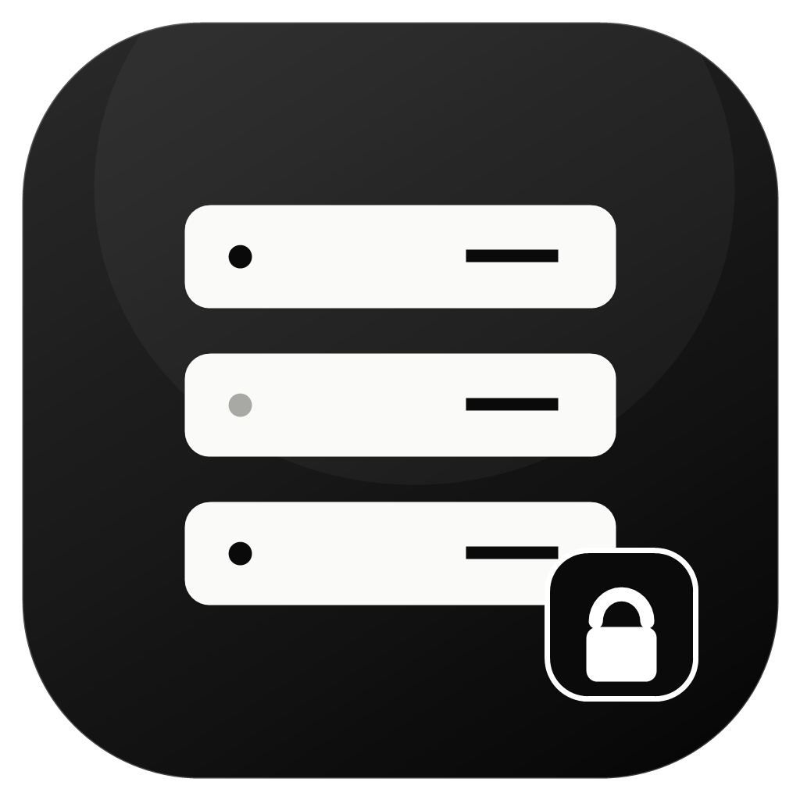

# Lumine SFTP

[](https://github.com/Megumi1608/LumineSFTP/releases/latest)

SFTP client desktop tối giản cho **Windows** và **macOS**, có nhập cấu hình kết nối bằng **mã QR**.

- Duyệt thư mục remote, tải lên / tải xuống, tạo thư mục, đổi tên, xoá.
- Nhập nhanh `host` / `port` / `username` từ ảnh QR (chọn file, kéo-thả, hoặc `Ctrl/Cmd+V`).
- Không lưu mật khẩu. Không telemetry.
- Kiểm tra **host key SHA-256** (TOFU) và chặn kết nối nếu khoá thay đổi.
- Tự động cập nhật qua **GitHub Releases** (Windows; macOS cần ký số — xem bên dưới).
- Giao diện **Tiếng Việt / English**, cùng bộ màu với khu khách LumineCloud: nền tối, vàng `#ffd500`, font Geist, bo góc 8px.

<p align="center">
  
</p>

Logo: [LumineCloud](https://luminecloud.com).

## Bắt đầu nhanh

Yêu cầu: **Node.js 22.12+**, npm.

```bash
npm install
npm run dev          # chạy ở chế độ phát triển
npm run typecheck    # kiểm tra TypeScript
npm test             # unit tests
npm run build        # build production vào out/
npm start            # chạy bản đã build
```

### Đóng gói

```bash
npm run package:win   # Windows: release/Lumine-SFTP-<version>-win-x64.exe (NSIS)
npm run package:mac   # macOS: release/Lumine-SFTP-<version>-mac-universal.dmg (chạy trên macOS)
```

- Bản macOS **phải build trên macOS**. Repo không dùng CI; build và upload thủ công.
- Bản build mặc định **chưa ký số**:
  - Windows SmartScreen: *More info → Run anyway*.
  - macOS Gatekeeper: `xattr -dr com.apple.quarantine "/Applications/Lumine SFTP.app"`.
- Muốn ký/notarize: cấu hình chứng chỉ khi build (Apple Developer ID / Windows code signing). Không bắt buộc để dùng cá nhân.

## Nhập từ QR

QR chứa JSON:

```json
{"host":"files.example.com","port":2022,"username":"demo-user"}
```

Quy trình:

1. Bấm **Nhập từ QR**.
2. Chọn ảnh QR, kéo-thả ảnh, hoặc dán ảnh / chuỗi JSON.
3. Kiểm tra preview (host, port, username) rồi bấm **Lưu & kết nối**.
4. Nhập mật khẩu khi được hỏi.

Chi tiết định dạng và các trường bị từ chối: [`docs/QR-FORMAT.md`](docs/QR-FORMAT.md).

> QR là dữ liệu không tin cậy. App **không tự kết nối**, **không nhận mật khẩu/khoá bí mật từ QR**, và luôn xác minh host key trước khi tin cậy máy chủ.

## Bảo mật

Tóm tắt (chi tiết: [`docs/SECURITY.md`](docs/SECURITY.md)):

- Mật khẩu chỉ nằm trong RAM trong lúc kết nối; **không ghi đĩa, không log**.
- Host key được pin theo `host:port`; lần đầu hiển thị fingerprint SHA-256 để xác nhận; **mismatch → chặn cứng**.
- Chỉ mở SFTP subsystem — không shell, không exec, không agent forwarding.
- Electron hardening: `sandbox`, `contextIsolation`, `nodeIntegration: false`, CSP chặt, từ chối mọi permission request, chặn navigation/new window, Electron fuses.
- Mọi IPC payload được validate ở main process; renderer không có quyền truy cập filesystem/network trực tiếp.
- Tên file do server trả về được sanitize trước khi ghi local (chống path traversal, reserved names Windows, tên quá dài).
- Không telemetry, không crash reporter.
- Auto-update chỉ đọc GitHub Releases qua HTTPS; `electron-updater` kiểm tra SHA-512 từ metadata `latest.yml`.
- Dữ liệu lưu local: `profiles.json`, `known_hosts.json`, `settings.json` trong thư mục userData; không chứa secret.

## Cập nhật & phát hành

### Người dùng

- App kiểm tra bản mới sau khi khởi động (sau ~12 giây) và trong **Cài đặt → Cập nhật**.
- **Windows**: tải bản NSIS mới, xác minh SHA-512, rồi hiện nút **Khởi động lại** để cài.
- **macOS**: bản build hiện tại **chưa ký số**, nên không thể tự cài cập nhật. App vẫn kiểm tra và mở trang GitHub Releases để tải DMG thủ công. Muốn auto-update trên macOS cần Apple Developer ID + notarization.
- Bản build chưa ký có thể bị SmartScreen/Gatekeeper cảnh báo.

### Phát hành bản mới (thủ công)

1. Tăng version trong `package.json` (ví dụ `0.1.1`).
2. Chạy test và build installer:
   ```bash
   npm install
   npm test
   npm run package:win     # trên Windows
   npm run package:mac     # trên macOS
   ```
3. Tạo release và upload asset (Windows):
   ```bash
   gh release create v0.1.1 \
     --title "Lumine SFTP 0.1.1" \
     --notes "..." \
     "release/Lumine-SFTP-0.1.1-win-x64.exe" \
     "release/Lumine-SFTP-0.1.1-win-x64.exe.blockmap" \
     "release/latest.yml"
   ```
4. Trên macOS, upload thêm `Lumine-SFTP-<version>-mac-universal.dmg`, file `.zip` và `latest-mac.yml`.
5. Release phải ở trạng thái **published** thì auto-update mới thấy.

Nếu muốn ký số: cấu hình chứng chỉ trên máy build (`CSC_LINK`, `CSC_KEY_PASSWORD`, Apple notarization). Khi macOS đã ký, đổi `canAutoUpdate` trong `src/main/updater.ts` để bật auto-install trên macOS.

## Dữ liệu lưu ở đâu

| Hệ điều hành | Thư mục |
|---|---|
| Windows | `%APPDATA%\Lumine SFTP` |
| macOS | `~/Library/Application Support/Lumine SFTP` |

Chỉ gồm danh sách kết nối (không mật khẩu), host key đã tin cậy và ngôn ngữ UI.

## Kiểm thử

```bash
npm test
```

Unit tests bao phủ parser QR, sanitize đường dẫn local, IPC contract, fingerprint host key.

### Integration test với SFTP server thật (Docker)

```bash
docker run -d --name lumine-sftp-test -p 2222:22 \
  -e SFTP_USERS="test:testpass:1001:100:upload" atmoz/sftp:alpine

# PowerShell
$env:SFTP_IT='1'; $env:SFTP_BASE='/upload'; npm run test:integration

# bash
SFTP_IT=1 SFTP_BASE=/upload npm run test:integration
```

Test sẽ: kết nối, nhận host key, list, upload, download (so sánh SHA-256), rename, delete, kiểm tra chặn host key mismatch, sai mật khẩu và chặn xoá `/`.

### Smoke test UI

```bash
node scripts/smoke.mjs        # mở app, kiểm tra render/CSP
node scripts/e2e-qr.mjs       # nhập QR thật → preview → lưu
node scripts/e2e-connect.mjs  # kết nối Docker SFTP, host key, tạo/đổi tên thư mục
```

Các script dùng `playwright-core` (không tải browser) và Electron đã cài.

## Cấu trúc

```
src/
  main/        Electron main: window, IPC, SSH/SFTP, store, path sanitizer
  preload/     contextBridge API hẹp
  shared/      types, IPC contract, QR parser (dùng chung + test)
  renderer/    React UI, i18n, QR decode, styles
tests/         Vitest
scripts/       smoke/e2e + tạo icon
docs/          SECURITY.md, QR-FORMAT.md
```

## Không nằm trong phạm vi (YAGNI)

Terminal/SSH shell · FTP/FTPS/S3 · sync thư mục · SSH key auth · port forwarding ·
lưu mật khẩu · quét camera · telemetry · sửa file remote · chmod.

## Giấy phép & ghi công

MIT — xem [`LICENSE`](LICENSE).

Tham khảo pattern bảo mật (host-key TOFU, IPC validation, vault) từ dự án
[harbor-ssh](https://github.com/miketam/harbor-ssh) (MIT). Không copy nguyên mã nguồn.
Thư viện bên thứ ba: xem [`THIRD_PARTY_NOTICES.md`](THIRD_PARTY_NOTICES.md).
